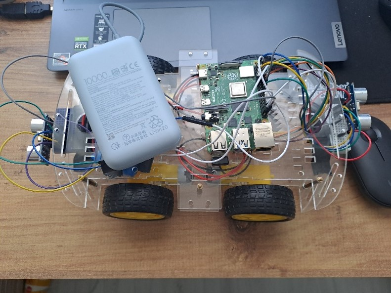

# Vision-Based Autonomous Mobile Robot

A Raspberry Pi 4-based mobile robot featuring AI-powered vision control, manual driving, and ultrasonic obstacle detection.

This project combines computer vision, embedded systems, motor control, and wireless communication to create a mobile robot capable of both manual and vision-based navigation.



## Features

- **AI-Based Vision Control:** Object detection using a custom-trained YOLO model.
- **Manual Control:** Keyboard-based robot movement using W, A, S, and D keys.
- **Ultrasonic Obstacle Detection:** Front and rear distance measurement using HC-SR04 sensors.
- **Obstacle Safety System:** Prevents movement toward detected obstacles.
- **Sensor Filtering:** Median filtering and consecutive measurement confirmation to reduce measurement noise.
- **Wireless Communication:** TCP/IP socket communication between the laptop and Raspberry Pi.

## System Architecture

The system consists of two main components:

### 1. Raspberry Pi – Robot Control

`raspberry_pi.py`

Runs on Raspberry Pi 4 and handles:

- L298N motor driver control
- Four DC motors
- Front and rear HC-SR04 ultrasonic sensors
- Obstacle detection and movement safety
- TCP server communication on port 5005

### 2. Laptop – Vision and Manual Control

`vision_control.py`

Runs on a laptop and handles:

- Real-time camera input using OpenCV
- Object detection using YOLO
- Manual keyboard control
- Vision-based movement decisions
- Communication with Raspberry Pi
- Display of front and rear distance measurements

## Hardware Requirements

- Raspberry Pi 4
- L298N motor driver
- 4 DC motors (one for each wheel)
- 2 HC-SR04 ultrasonic sensors
- Laptop camera or compatible external camera
- Laptop for vision processing
- Power bank for Raspberry Pi
- Separate battery for DC motors
- Robot chassis and connecting wires

## GPIO Pin Configuration

All GPIO numbers below use BCM numbering.

### L298N Motor Driver

| L298N Pin | Raspberry Pi GPIO | Physical Pin |
|---|---|---|
| ENA | GPIO18 | 12 |
| IN1 | GPIO17 | 11 |
| IN2 | GPIO27 | 13 |
| ENB | GPIO19 | 35 |
| IN3 | GPIO22 | 15 |
| IN4 | GPIO23 | 16 |

The L298N motor driver controls the four DC motors through its two motor output channels. Refer to the actual hardware wiring when connecting the motors.

### Front HC-SR04 Sensor

| Sensor Pin | Raspberry Pi GPIO | Physical Pin |
|---|---|---|
| TRIG | GPIO25 | 22 |
| ECHO | GPIO24 | 18 |

### Rear HC-SR04 Sensor

| Sensor Pin | Raspberry Pi GPIO | Physical Pin |
|---|---|---|
| TRIG | GPIO26 | 37 |
| ECHO | GPIO20 | 38 |

**Important:** HC-SR04 ECHO outputs may operate at 5V. Raspberry Pi GPIO inputs are 3.3V tolerant. Use an appropriate voltage divider or logic-level converter.

## Power Configuration

The Raspberry Pi and DC motors use separate power sources:

- Raspberry Pi 4: Powered by a power bank.
- DC motors: Powered by a separate battery.

The grounds of the Raspberry Pi and motor driver must be connected together for proper signal reference.

## Communication

The laptop and Raspberry Pi communicate over a TCP/IP socket connection.

- Protocol: TCP
- Port: 5005
- Raspberry Pi: Server
- Laptop: Client

Before running the laptop application, update `PI_IP` in `vision_control.py` with the Raspberry Pi's current IP address.

## Software Requirements

- Python 3
- OpenCV
- Ultralytics YOLO
- RPi.GPIO (Raspberry Pi only)

The trained YOLO model is included in this repository as `best.pt`.

## Installation and Setup

### Raspberry Pi

Install the required GPIO library:

```bash
pip install RPi.GPIO
```

Run the robot control server:

```bash
python3 raspberry_pi.py
```

### Laptop

Install the required packages:

```bash
pip install opencv-python ultralytics
```

Make sure `best.pt` is located in the same directory as `vision_control.py`.

Update the Raspberry Pi IP address in the Python file:

```python
PI_IP = "YOUR_RASPBERRY_PI_IP"
```

Run the vision and manual control application:

```bash
python vision_control.py
```

## Camera Configuration

The application uses OpenCV's camera interface:

```python
cap = cv2.VideoCapture(0)
```

The default camera index is `0`, which usually refers to the laptop's built-in camera.

If an external USB camera or another camera device is used, change the camera index according to the connected device.

## Control Instructions

| Key | Function |
|---|---|
| W | Move Forward |
| S | Move Backward |
| A | Turn Left |
| D | Turn Right |
| Space | Stop |
| V | Activate Vision Mode |
| M | Activate Manual Mode |
| Q | Quit Application |

## AI Vision Control

The robot uses a custom-trained YOLO model to determine movement commands based on detected object classes and their positions in the camera frame.

A consecutive-frame confirmation mechanism is implemented to improve command stability and reduce sudden movements caused by individual incorrect predictions.

## Obstacle Safety System

The robot uses front and rear ultrasonic sensors.

The safety system includes:

- Median filtering with a five-measurement window.
- Three consecutive low-distance confirmations.
- A 30 cm obstacle detection threshold.
- Direction-based movement restrictions.

These mechanisms help reduce false detections and prevent movement toward detected obstacles.

## Future Improvements

- Improve YOLO model accuracy with additional training data.
- Optimize real-time object detection performance.
- Improve obstacle avoidance and navigation logic.
- Refine hardware wiring and system integration.
- Implement more advanced autonomous navigation.

## Project Structure

```text
main_project/
│
├── raspberry_pi.py
├── vision_control.py
├── best.pt
├── robot_hardware.jpg
└── README.md
```

## Technologies

Python | Raspberry Pi 4 | OpenCV | YOLO | Ultralytics | RPi.GPIO | TCP/IP | HC-SR04 | L298N

---

Developed as a graduation project focusing on computer vision, robotics, and embedded systems.
